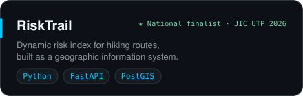
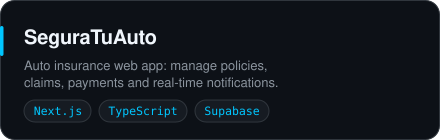
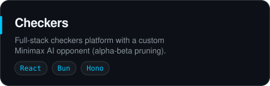
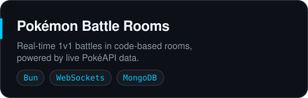
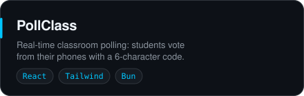
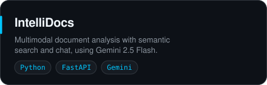

  

  &nbsp;
  &nbsp;
  &nbsp;
  

 

- 🎓 I am a <code>fourth-year student</code> in the <strong>Software Development and Management</strong> program at .
- <picture></picture>💻 Aspiring <code>Fullstack Developer</code>, passionate about creating frontend and backend solutions.
- 🔧 Skilled in: <code>Java</code>, <code>C#</code>, <code>JavaScript</code>, <code>PHP</code>, <code>Python</code>, <code>HTML</code>, <code>CSS</code>.
- 🗃️ Experienced with databases like <code>SQL Server</code> and <code>MySQL</code>.
- 👨‍💻 I love using technology to solve real-world <code>problems</code>.
- 🌍 I speak <code>Spanish (Native)</code>, <code>English (Intermediate B1+)</code>, <code>Mandarin (Intermediate HSK4)</code>, and <code>Cantonese (Basic Conversational)</code>.
- 🌱 Constantly learning and adapting to <code>new technologies</code> and <code>agile methodologies</code>.
- 🤝 Strong background in <code>teamwork</code>, <code>communication</code>, and <code>problem-solving</code>.
- 💥 You can visit .
- 📬 You can view  () or visit my .

 

#### 🔧 Languages

#### 🖥️ Frameworks

#### 🗄️ Databases

#### 🧰 Database Tools

#### 💻 IDEs & Editors

#### 🎨 UI/UX & Design

#### ⚙️ DevOps & Tools

 

  
  
  
  
  
  

More on  and .

 

  

 

  &nbsp;
  &nbsp;
  &nbsp;
  &nbsp;
  

  
  

